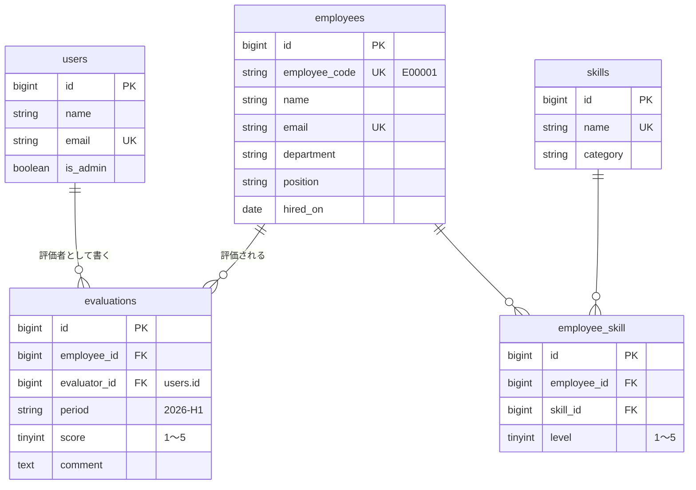

<p align="center">
  
</p>

<h1 align="center">Hinata — 社員スキル・評価管理システム</h1>

<p align="center">
  社員のスキルと半期ごとの評価をまとめて管理する Web アプリケーションです。<br>
  Laravel + Vue 3 (Inertia.js) + PostgreSQL で作成し、外部連携用の REST API も備えています。
</p>

<p align="center">
  <a href="https://github.com/DevMonkey3/skill-eval-app/actions/workflows/tests.yml"></a>
</p>

---

## 概要

社員ごとに「どのスキルをどのレベルで持っているか」と「上期・下期の評価」を記録し、
ダッシュボードで今期の評価状況や保有者の多いスキルを確認できます。

- **社員管理**: 登録・編集・削除、名前 / 社員番号での検索、部署での絞り込み
- **スキル管理**: カテゴリ別の一覧、保有者数と平均レベルの表示
- **スキル割り当て**: 社員ごとにスキルを追加し、レベル (1〜5) をその場で変更
- **評価管理**: 社員 × 評価期間 (例: `2026-H1`) ごとにスコア (1〜5) とコメントを登録
- **権限**: 社員・スキルの登録 / 編集 / 削除は管理者だけ。評価を編集・削除できるのは、その評価を書いた本人だけ
- **REST API**: Sanctum のトークン認証で社員・評価を取得 / 登録 / 更新 / 削除
- **ダッシュボード**: 社員数・スキル数・今期の評価数と平均スコア、保有者の多いスキル、最近の評価

## 使用技術

| 分類           | 技術                                                                   |
| -------------- | ---------------------------------------------------------------------- |
| 言語           | PHP 8.4 / TypeScript                                                   |
| バックエンド   | Laravel 13                                                             |
| フロントエンド | Vue 3 / Inertia.js v3 / Tailwind CSS v4 / shadcn-vue                   |
| ルーティング   | Laravel Wayfinder (Laravel のルートを TypeScript の関数として使う)     |
| 認証           | Laravel Fortify (画面・二要素認証・パスキー) / Laravel Sanctum (API)   |
| データベース   | PostgreSQL 18 (Docker / CI) ・ SQLite (Docker なしのローカル開発)      |
| 開発環境       | Docker (Laravel Sail)                                                  |
| テスト・品質   | PHPUnit / Larastan (PHPStan level 7) / Laravel Pint / vue-tsc / Oxlint |
| CI             | GitHub Actions (PostgreSQL 18 のコンテナ上でテスト)                    |

## データベース設計 (ER 図)



- `employee_skill` は (employee_id, skill_id) でユニーク
- `evaluations` は (employee_id, evaluator_id, period) でユニーク (同じ人が同じ期間に二重評価できない)
- 社員を削除すると、スキルの紐付けと評価も外部キーの `cascadeOnDelete` で削除される
- 外部キーと絞り込みに使う列にはインデックスを作成 (PostgreSQL は外部キーに自動でインデックスを作らないため)

## ダウンロードと起動方法

### 方法 1: Docker (Laravel Sail) で起動する ※PostgreSQL で動きます

**必要なもの**: Git, Docker Desktop

```bash
# 1. ダウンロード
git clone https://github.com/DevMonkey3/skill-eval-app.git
cd skill-eval-app
cp .env.example .env

# 2. PHP がなくても composer install できるように、コンテナで実行
docker run --rm -v "$(pwd):/var/www/html" -w /var/www/html laravelsail/php84-composer:latest composer install

# 3. 起動 (アプリと PostgreSQL のコンテナが立ち上がる)
./vendor/bin/sail up -d

# 4. 初期設定とデモデータの投入
./vendor/bin/sail artisan key:generate
./vendor/bin/sail artisan migrate --seed
./vendor/bin/sail npm install
./vendor/bin/sail npm run build
```

ブラウザで **http://localhost** を開きます。停止は `./vendor/bin/sail down` です。

### 方法 2: Docker を使わずに起動する (SQLite)

**必要なもの**: Git, PHP 8.4 以上, Composer 2, Node.js 22 以上

```bash
# 1. ダウンロード
git clone https://github.com/DevMonkey3/skill-eval-app.git
cd skill-eval-app

# 2. ライブラリのインストール
composer install
npm install

# 3. 設定ファイルの作成 (Windows の PowerShell では copy .env.example .env)
cp .env.example .env
php artisan key:generate
```

`.env` の `DB_` で始まる 6 行を、次の 1 行に置き換えます。

```
DB_CONNECTION=sqlite
```

```bash
# 4. テーブル作成とデモデータの投入
#    「database.sqlite を作成しますか？」と聞かれたら yes
php artisan migrate --seed

# 5. 起動 (Laravel のサーバーと Vite が一緒に立ち上がる)
composer run dev
```

ブラウザで **http://127.0.0.1:8000** を開きます。停止は `Ctrl + C` です。

> 停止したあとに画面が真っ白になる場合は、`public/hot` ファイルが残っています。削除してください。

### デモアカウント

どちらもパスワードは `password` です。

| メールアドレス      | 権限                                              |
| ------------------- | ------------------------------------------------- |
| test@example.com    | 管理者 (社員・スキルの登録 / 編集 / 削除もできる) |
| manager@example.com | 一般ユーザー (閲覧と評価の登録だけ)               |

デモデータとして、社員 40 名・スキル 15 件・評価 80 件が登録されます。新規登録したユーザーは一般ユーザーになります。

## REST API

すべて `Accept: application/json` を付けて呼び出します。`POST /api/tokens` 以外は `Authorization: Bearer <token>` が必要です。

- トークンはメール認証済みのユーザーにだけ発行し、二要素認証を有効にしている場合は `code` (認証アプリの 6 桁) も必要です
- トークンの有効期限は 30 日。期限切れのトークンは毎日削除します
- API 全体で 1 ユーザーあたり 1 分 60 回まで (トークン発行は 1 分 10 回まで)
- `PUT` は全項目、`PATCH` は送った項目だけを更新します

| メソッド    | URL                     | 内容                                                   |
| ----------- | ----------------------- | ------------------------------------------------------ |
| POST        | `/api/tokens`           | トークン発行 (email, password, device_name, code)      |
| DELETE      | `/api/tokens/current`   | 今のトークンを無効化                                   |
| GET         | `/api/user`             | ログイン中のユーザー                                   |
| GET         | `/api/employees`        | 社員一覧 (`search`, `department`, `per_page` ※最大100) |
| POST        | `/api/employees`        | 社員登録 (管理者のみ)                                  |
| GET         | `/api/employees/{id}`   | 社員詳細 (スキルとレベル付き)                          |
| PUT / PATCH | `/api/employees/{id}`   | 社員更新 (管理者のみ)                                  |
| DELETE      | `/api/employees/{id}`   | 社員削除 (管理者のみ)                                  |
| GET         | `/api/evaluations`      | 評価一覧 (`period`, `employee_id`, `per_page`)         |
| POST        | `/api/evaluations`      | 評価登録 (評価者はトークンの持ち主)                    |
| GET         | `/api/evaluations/{id}` | 評価詳細                                               |
| PUT / PATCH | `/api/evaluations/{id}` | 評価更新 (評価者本人のみ。他人は 403)                  |
| DELETE      | `/api/evaluations/{id}` | 評価削除 (評価者本人のみ)                              |

```bash
# トークンを発行 (Docker なしで起動した場合は http://127.0.0.1:8000)
curl -X POST http://localhost/api/tokens \
  -H "Accept: application/json" \
  -d email=test@example.com -d password=password -d device_name=cli

# 社員一覧を取得
curl http://localhost/api/employees \
  -H "Accept: application/json" \
  -H "Authorization: Bearer <発行されたトークン>"
```

主なステータスコード: `200` 成功 / `201` 作成 / `204` 削除 / `401` 未認証 / `403` 権限なし / `404` 存在しない / `422` 入力エラー / `429` 回数制限

## テスト

```bash
npm run build          # 画面のテストが Vite のビルド結果を使うため、先に 1 回実行
composer test          # Pint (コード整形) + PHPStan (静的解析) + PHPUnit
npm run check          # Oxlint + フォーマット
npm run types:check    # TypeScript の型チェック
```

Docker の場合は先頭に `./vendor/bin/sail` を付けます (例: `./vendor/bin/sail composer test`)。

テストは 97 件です。ローカルではメモリ上の SQLite で動くため、開発用のデータは消えません。GitHub Actions では PostgreSQL 18 のコンテナを立ち上げ、本番と同じ DB でテストしています。

| 種類           | 主な内容                                                                                                 |
| -------------- | -------------------------------------------------------------------------------------------------------- |
| Feature (画面) | 未ログイン時のリダイレクト、CRUD、検索・絞り込み、バリデーション、スキルの追加・レベル変更               |
| Feature (権限) | 一般ユーザーは社員・スキルを変更できない (画面・API とも 403)、他人の評価は 403、新規登録で管理者になれない |
| Feature (API)  | トークン発行・失効、メール未認証・二要素認証、回数制限、401 / 404 / 422 / 403、`per_page` の上限、PATCH |
| Feature (境界) | 数字以外の ID は 404、検索の `%` `_` は文字として扱う、ページ送りで絞り込みが残る、ダッシュボードの集計  |
| Unit           | 評価期間の判定 (4〜9月 = H1、10〜3月 = H2、1〜3月は前年度)                                               |

## 工夫した点

- **評価者のなりすまし防止**: `evaluator_id` は Fillable に含めず、`$request->user()->evaluations()->create()` で必ずログインユーザーを評価者にしています。
- **認可は Policy / Gate に集約**: 「評価の編集・削除は書いた本人だけ」を `EvaluationPolicy` に、「社員・スキルの変更は管理者だけ」を Gate `admin` にまとめ、画面と API の両方で同じルールを使っています。画面のボタンを隠すのは見た目だけで、実際の判定はサーバー側です。
- **API も画面と同じ安全基準**: トークン発行時にメール認証と二要素認証を確認し、トークンの有効期限と回数制限を設定しています。
- **Form Request の共有**: 画面と API で同じ Form Request を使い、画面ではフォームにエラーを、API では 422 の JSON を返しています。
- **PostgreSQL を前提にした作り**: 数字以外の ID はルートの段階で 404 にし、一覧は `id` でも並べてページ間で行が重複・欠落しないようにしています。
- **N+1 対策**: `with()` / `withCount()` / `withAvg()` でまとめて取得し、開発中は `Model::preventLazyLoading()` で付け忘れを例外にしています。
- **型のある画面遷移**: Wayfinder でルートを TypeScript の関数として呼び出すため、URL の書き間違いがビルド時に分かります。
- **日本の会計年度**: 評価期間は 4 月始まりの上期 / 下期で自動判定し、境界の日付をユニットテストしています。

## 今後の改善予定

- 部署ごとのスキル分布や評価推移のグラフ
- 社員の論理削除 (削除しても過去の評価を残す)
- 評価フォームの社員選択を検索式にする
- 評価の CSV 出力
- AWS (ECS + RDS) へのデプロイ
