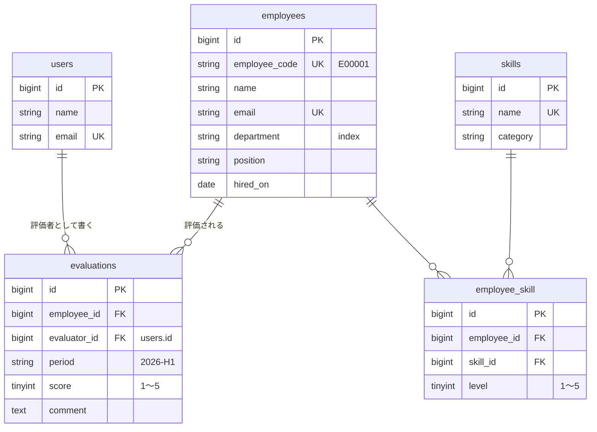

<p align="center">
  
</p>

<h1 align="center">Hinata — 社員スキル・評価管理システム</h1>

<p align="center">
  社員のスキルと半期ごとの評価をまとめて管理する Web アプリケーションです。<br>
  Laravel + Vue 3 (Inertia.js) + PostgreSQL で作成し、外部連携用の REST API も備えています。
</p>

<p align="center">
  <a href="https://github.com/DevMonkey3/skill-eval-app/actions/workflows/tests.yml"></a>
</p>

---

## 概要

社員ごとに「どのスキルをどのレベルで持っているか」と「上期・下期の評価」を記録し、
ダッシュボードで今期の評価状況や保有者の多いスキルを確認できます。

- **社員管理**: 登録・編集・削除、名前 / 社員番号での検索、部署での絞り込み
- **スキル管理**: カテゴリ別の一覧、保有者数と平均レベルの表示
- **スキル割り当て**: 社員ごとにスキルを追加し、レベル (1〜5) をその場で変更
- **評価管理**: 社員 × 評価期間 (例: `2026-H1`) ごとにスコア (1〜5) とコメントを登録
- **権限**: 評価を編集・削除できるのは、その評価を書いた本人だけ
- **REST API**: Sanctum のトークン認証で社員・評価を取得 / 登録 / 更新 / 削除
- **ダッシュボード**: 社員数・スキル数・今期の評価数と平均スコア、最近の評価

## 使用技術

| 分類           | 技術                                                                   |
| -------------- | ---------------------------------------------------------------------- |
| バックエンド   | PHP 8.4 / Laravel 13                                                   |
| フロントエンド | Vue 3 (TypeScript) / Inertia.js v3 / Tailwind CSS v4 / shadcn-vue      |
| ルーティング   | Laravel Wayfinder (Laravel のルートを TypeScript の関数として使う)     |
| 認証           | Laravel Fortify (画面) / Laravel Sanctum (API トークン)                |
| データベース   | PostgreSQL 18 (Docker / CI) ・ SQLite (ローカル開発でも可)             |
| 開発環境       | Docker (Laravel Sail)                                                  |
| テスト・品質   | PHPUnit / Larastan (PHPStan level 7) / Laravel Pint / vue-tsc / Oxlint |
| CI             | GitHub Actions (PostgreSQL 上でテスト)                                 |

## ER 図



- `employee_skill` は (employee_id, skill_id) でユニーク
- `evaluations` は (employee_id, evaluator_id, period) でユニーク (同じ人が同じ期間に二重評価できない)
- 社員を削除すると、スキルの紐付けと評価も外部キーの `cascadeOnDelete` で消える

## REST API

すべて `Accept: application/json` を付けて呼び出します。`/api/tokens` (POST) 以外は `Authorization: Bearer <token>` が必要です。

| メソッド | URL                     | 内容                                                       |
| -------- | ----------------------- | ---------------------------------------------------------- |
| POST     | `/api/tokens`           | トークン発行 (email, password, device_name)。1分に10回まで |
| DELETE   | `/api/tokens/current`   | 今のトークンを無効化                                       |
| GET      | `/api/user`             | ログイン中のユーザー                                       |
| GET      | `/api/employees`        | 社員一覧 (`search`, `department`, `per_page` ※最大100)     |
| POST     | `/api/employees`        | 社員登録                                                   |
| GET      | `/api/employees/{id}`   | 社員詳細 (スキルとレベル付き)                              |
| PUT      | `/api/employees/{id}`   | 社員更新                                                   |
| DELETE   | `/api/employees/{id}`   | 社員削除                                                   |
| GET      | `/api/evaluations`      | 評価一覧 (`period`, `employee_id`, `per_page`)             |
| POST     | `/api/evaluations`      | 評価登録 (評価者はトークンの持ち主)                        |
| GET      | `/api/evaluations/{id}` | 評価詳細                                                   |
| PUT      | `/api/evaluations/{id}` | 評価更新 (評価者本人のみ。他人は 403)                      |
| DELETE   | `/api/evaluations/{id}` | 評価削除 (評価者本人のみ)                                  |

```bash
# トークンを発行
curl -X POST http://localhost/api/tokens \
  -H "Accept: application/json" \
  -d email=test@example.com -d password=password -d device_name=cli

# 社員一覧を取得
curl http://localhost/api/employees -H "Accept: application/json" -H "Authorization: Bearer <token>"
```

主なステータスコード: `200` 成功 / `201` 作成 / `204` 削除 / `401` 未認証 / `403` 権限なし / `404` 存在しない / `422` 入力エラー / `429` 回数制限

## 環境構築 (Docker / Laravel Sail)

```bash
git clone https://github.com/DevMonkey3/skill-eval-app.git
cd skill-eval-app
cp .env.example .env

# PHP がローカルに無くても composer install できるようにコンテナで実行
docker run --rm -v "$(pwd):/var/www/html" -w /var/www/html laravelsail/php84-composer:latest composer install

./vendor/bin/sail up -d
./vendor/bin/sail artisan key:generate
./vendor/bin/sail artisan migrate --seed
./vendor/bin/sail npm install
./vendor/bin/sail npm run build
```

http://localhost を開き、次のデモアカウントでログインできます (どちらもパスワードは `password`)。

| メールアドレス      | 用途                      |
| ------------------- | ------------------------- |
| test@example.com    | 一般ユーザー              |
| manager@example.com | 別の評価者 (権限の確認用) |

### Docker を使わない場合 (SQLite)

PHP 8.4・Composer・Node.js があれば、SQLite でそのまま動かせます。

```bash
cp .env.example .env
# .env の DB_ で始まる 6 行を「DB_CONNECTION=sqlite」の 1 行にする

composer install
php artisan key:generate
php artisan migrate --seed   # database/database.sqlite が無ければ作成を確認されます
npm install
composer run dev             # http://localhost:8000
```

## テスト

```bash
./vendor/bin/sail composer test   # Pint + PHPStan + PHPUnit
./vendor/bin/sail npm run check   # Oxlint + フォーマット
./vendor/bin/sail npm run types:check
```

ローカルのテストはメモリ上の SQLite で動くため、開発用のデータは消えません。テストの前に `npm run build` が必要です (画面のテストが Vite のビルド結果を読むため)。

| 種類           | 主な内容                                                                                                     |
| -------------- | ------------------------------------------------------------------------------------------------------------ |
| Feature (画面) | 未ログイン時のリダイレクト、CRUD、検索・絞り込み、バリデーション、スキルの追加・レベル変更、他人の評価は 403 |
| Feature (API)  | トークン発行・失効、401 / 404 / 422 / 403、`per_page` の上限、JSON の構造                                    |
| Unit           | 評価期間の判定 (4〜9月 = H1、10〜3月 = H2、1〜3月は前年度)                                                   |

GitHub Actions では PostgreSQL 18 のコンテナを立ち上げ、本番と同じ DB でテストしています。

## 工夫した点

- **評価者のなりすまし防止**: `evaluator_id` は Fillable に含めず、`$request->user()->evaluations()->create()` で必ずログインユーザーを評価者にしています。フォームに `evaluator_id` を足して送っても無視されることをテストで確認しています。
- **認可は Policy に集約**: 「評価を編集・削除できるのは書いた本人だけ」を `EvaluationPolicy` にまとめ、画面と API の両方から同じルールを使っています。画面のボタンを隠すのは見た目だけで、実際の判定はサーバー側です。
- **二重チェックの一意制約**: 同じ期間の重複評価は Form Request で分かりやすいメッセージを返し、さらに DB のユニーク制約で同時リクエストにも備えています。
- **Form Request の共有**: 画面と API で同じ Form Request を使い、画面ではエラーをフォームに、API では 422 の JSON で返しています。
- **N+1 対策**: `with()` / `withCount()` / `withAvg()` で必要なデータをまとめて取得し、開発中は `Model::preventLazyLoading()` で付け忘れを例外にしています。
- **API の安全策**: API Resource で返す項目を限定 (評価者のメールアドレスなどは出さない)、`per_page` は最大100、トークン発行は 1 分 10 回までに制限しています。
- **型のある画面遷移**: Wayfinder でルートを TypeScript の関数として呼び出すため、URL の書き間違いがビルド時に分かります。
- **日本の会計年度**: 評価期間は 4 月始まりの上期 / 下期で自動判定し、境界の日付をユニットテストしています。

## 今後の改善予定

- 部署ごとのスキル分布や評価推移のグラフ
- 管理者 / 一般ユーザーのロール分け
- 評価の CSV 出力
- AWS (ECS + RDS) へのデプロイ
