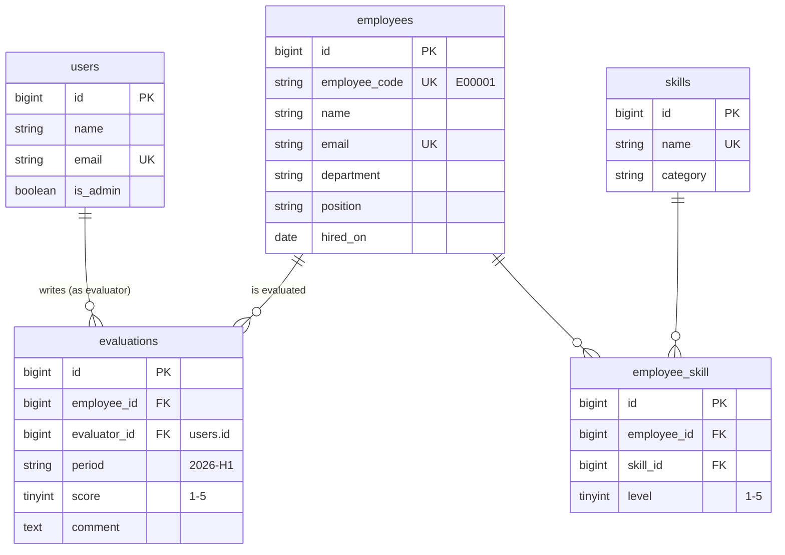

<p align="center">
  
</p>

<h1 align="center">Hinata — Employee Skill & Evaluation Management System</h1>

<p align="center">
  A web application for managing employees' skills and half-year performance evaluations in one place.<br>
  Built with Laravel + Vue 3 (Inertia.js) + PostgreSQL, with a REST API for integration with other systems.
</p>

---

## Overview

Record which skills each employee has and at what level, along with their first-half / second-half evaluations.
The dashboard shows this period's evaluation status and the most common skills at a glance.

- **Employee management**: create, edit, delete, search by name / employee code, filter by department
- **Skill management**: list by category, with the number of holders and the average level
- **Skill assignment**: add skills to each employee and change the level (1–5) inline
- **Evaluation management**: record a score (1–5) and a comment per employee × evaluation period (e.g. `2026-H1`)
- **Permissions**: only admins can create / edit / delete employees and skills; only the person who wrote an evaluation can edit or delete it
- **REST API**: read / create / update / delete employees and evaluations with Sanctum token authentication
- **Dashboard**: employee count, skill count, this period's evaluation count and average score, most common skills, recent evaluations

## Tech Stack

| Category        | Technology                                                                    |
| --------------- | ----------------------------------------------------------------------------- |
| Languages       | PHP 8.4 / TypeScript                                                          |
| Backend         | Laravel 13                                                                    |
| Frontend        | Vue 3 / Inertia.js v3 / Tailwind CSS v4 / shadcn-vue                          |
| Routing         | Laravel Wayfinder (call Laravel routes as typed TypeScript functions)         |
| Authentication  | Laravel Fortify (web login, two-factor auth, passkeys) / Laravel Sanctum (API) |
| Database        | PostgreSQL 18 (Docker / CI) · SQLite (local development without Docker)       |
| Dev environment | Docker (Laravel Sail)                                                         |
| Testing/quality | PHPUnit / Larastan (PHPStan level 7) / Laravel Pint / vue-tsc / Oxlint        |
| CI              | GitHub Actions (tests run against a PostgreSQL 18 container)                  |

## Database Design (ER Diagram)



- `employee_skill` is unique on (employee_id, skill_id)
- `evaluations` is unique on (employee_id, evaluator_id, period), so the same person cannot evaluate the same employee twice in one period
- Deleting an employee also deletes their skill links and evaluations via the foreign keys' `cascadeOnDelete`
- Foreign keys and filtered columns have indexes (PostgreSQL does not index foreign keys automatically)

## Download and Run

### Option 1: Docker (Laravel Sail) — runs on PostgreSQL

**Requirements**: Git, Docker Desktop

```bash
# 1. Download
git clone https://github.com/DevMonkey3/skill-eval-app.git
cd skill-eval-app
cp .env.example .env

# 2. Run composer install inside a container (no local PHP needed)
docker run --rm -v "$(pwd):/var/www/html" -w /var/www/html laravelsail/php84-composer:latest composer install

# 3. Start the app and PostgreSQL containers
./vendor/bin/sail up -d

# 4. Initial setup and demo data
./vendor/bin/sail artisan key:generate
./vendor/bin/sail artisan migrate --seed
./vendor/bin/sail npm install
./vendor/bin/sail npm run build
```

Open **http://localhost** in your browser. Stop with `./vendor/bin/sail down`.

### Option 2: Without Docker (SQLite)

**Requirements**: Git, PHP 8.4+, Composer 2, Node.js 22+

```bash
# 1. Download
git clone https://github.com/DevMonkey3/skill-eval-app.git
cd skill-eval-app

# 2. Install dependencies
composer install
npm install

# 3. Create the config file (on Windows PowerShell: copy .env.example .env)
cp .env.example .env
php artisan key:generate
```

In `.env`, replace the six lines starting with `DB_` with this single line:

```
DB_CONNECTION=sqlite
```

```bash
# 4. Create the tables and load demo data
#    Answer "yes" when asked whether to create database.sqlite
php artisan migrate --seed

# 5. Start (runs the Laravel server and Vite together)
composer run dev
```

Open **http://127.0.0.1:8000** in your browser. Stop with `Ctrl + C`.

> If the page is blank after you stop the dev server, a leftover `public/hot` file is the cause. Delete it.

### Demo Accounts

The password for both is `password`.

| Email               | Role                                                  |
| ------------------- | ----------------------------------------------------- |
| test@example.com    | Admin (can also create / edit / delete employees and skills) |
| manager@example.com | Regular user (can view and write evaluations only)    |

The demo data includes 40 employees, 15 skills and 80 evaluations. Newly registered users are regular users.

## REST API

Send `Accept: application/json` with every request. Everything except `POST /api/tokens` requires `Authorization: Bearer <token>`.

- Tokens are only issued to users with a verified email address; users with two-factor authentication enabled must also send `code` (the 6-digit code from their authenticator app)
- Tokens expire after 30 days; expired tokens are deleted daily
- The whole API is limited to 60 requests per minute per user (token issuing: 10 per minute)
- `PUT` updates all fields; `PATCH` updates only the fields you send

| Method      | URL                     | Description                                               |
| ----------- | ----------------------- | --------------------------------------------------------- |
| POST        | `/api/tokens`           | Issue a token (email, password, device_name, code)        |
| DELETE      | `/api/tokens/current`   | Revoke the current token                                  |
| GET         | `/api/user`             | The logged-in user                                        |
| GET         | `/api/employees`        | List employees (`search`, `department`, `per_page` max 100) |
| POST        | `/api/employees`        | Create an employee (admin only)                           |
| GET         | `/api/employees/{id}`   | Employee details (with skills and levels)                 |
| PUT / PATCH | `/api/employees/{id}`   | Update an employee (admin only)                           |
| DELETE      | `/api/employees/{id}`   | Delete an employee (admin only)                           |
| GET         | `/api/evaluations`      | List evaluations (`period`, `employee_id`, `per_page`)    |
| POST        | `/api/evaluations`      | Create an evaluation (the token owner is the evaluator)   |
| GET         | `/api/evaluations/{id}` | Evaluation details                                        |
| PUT / PATCH | `/api/evaluations/{id}` | Update an evaluation (evaluator only; others get 403)     |
| DELETE      | `/api/evaluations/{id}` | Delete an evaluation (evaluator only)                     |

```bash
# Issue a token (use http://127.0.0.1:8000 if you started without Docker)
curl -X POST http://localhost/api/tokens \
  -H "Accept: application/json" \
  -d email=test@example.com -d password=password -d device_name=cli

# List employees
curl http://localhost/api/employees \
  -H "Accept: application/json" \
  -H "Authorization: Bearer <your-token>"
```

Main status codes: `200` OK / `201` Created / `204` Deleted / `401` Unauthenticated / `403` Forbidden / `404` Not found / `422` Validation error / `429` Too many requests

## Tests

```bash
npm run build          # Run once first: the page tests read the Vite build output
composer test          # Pint (code style) + PHPStan (static analysis) + PHPUnit
npm run check          # Oxlint + formatting
npm run types:check    # TypeScript type check
```

With Docker, prefix commands with `./vendor/bin/sail` (e.g. `./vendor/bin/sail composer test`).

There are 97 tests. Locally they run on an in-memory SQLite database, so your development data is never touched. GitHub Actions starts a PostgreSQL 18 container and runs the tests on the same database as production.

| Type                | What is covered                                                                                                  |
| ------------------- | ---------------------------------------------------------------------------------------------------------------- |
| Feature (web)       | Redirect when logged out, CRUD, search and filters, validation, adding skills and changing levels                |
| Feature (permissions) | Regular users cannot change employees or skills (403 on web and API), others' evaluations are 403, registration cannot grant admin |
| Feature (API)       | Token issue / revoke, unverified email and two-factor auth, rate limiting, 401 / 404 / 422 / 403, `per_page` cap, PATCH |
| Feature (edge cases) | Non-numeric IDs return 404, `%` and `_` in search are plain text, pagination keeps filters, dashboard totals     |
| Unit                | Evaluation period logic (Apr–Sep = H1, Oct–Mar = H2, Jan–Mar belongs to the previous fiscal year)                |

## Design Highlights

- **Evaluator spoofing prevention**: `evaluator_id` is not mass-assignable. Evaluations are always created through `$request->user()->evaluations()->create()`, so the evaluator is always the logged-in user.
- **Authorization in one place**: "only the author can edit or delete an evaluation" lives in `EvaluationPolicy`, and "only admins can change employees and skills" lives in the `admin` Gate. The web pages and the API share the same rules. Hiding buttons in the UI is cosmetic; the real checks happen on the server.
- **The API is as secure as the web login**: issuing a token checks email verification and two-factor authentication, and tokens have an expiry and a rate limit.
- **Shared Form Requests**: the web pages and the API use the same Form Requests; the web shows errors on the form, the API returns 422 JSON.
- **Built for PostgreSQL**: non-numeric IDs are rejected with a 404 at the routing layer, and lists are also ordered by `id` so rows are never duplicated or skipped between pages.
- **N+1 prevention**: data is loaded with `with()` / `withCount()` / `withAvg()`, and `Model::preventLazyLoading()` throws during development if eager loading is missing.
- **Typed navigation**: Wayfinder exposes routes as TypeScript functions, so a mistyped URL is caught at build time.
- **Japanese fiscal year**: evaluation periods are calculated automatically from an April-start fiscal year (first half / second half), with unit tests on the boundary dates.

## Roadmap

- Charts for skill distribution by department and evaluation trends
- Soft-deleting employees (keep past evaluations after deletion)
- Searchable employee picker on the evaluation form
- CSV export of evaluations
- Deployment to AWS (ECS + RDS)
